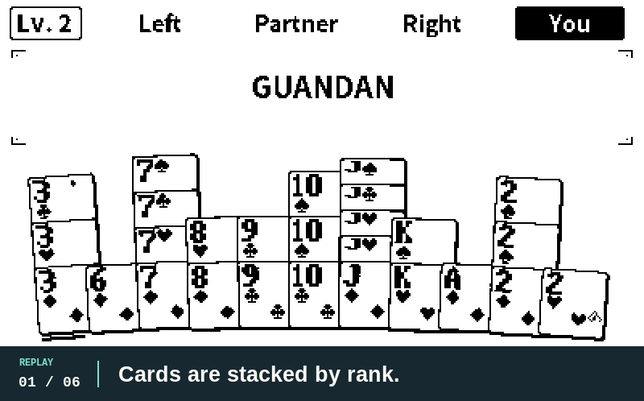
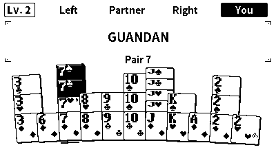
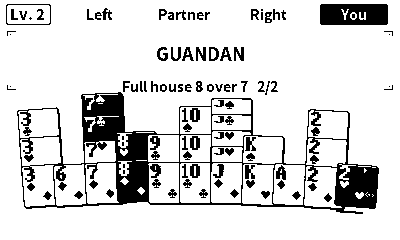

# Pocket Guandan

A four-player partnership card game for the **400 × 240 monochrome LCD on a Lapis device**. You and the bot across the table play against two other bots. Your 27 cards fan out by rank, with matching cards stacked vertically so you can see each suit. Once a card reaches the table, it stays spread out beside the name of the player who played it.

[中文说明](docs/README.zh-CN.md) · [Match rules](MATCH_RULES.md)

## Demo



The demo uses the game's English LCD renderer and a seeded deal. It shows the pixels the app draws, not a camera recording of the device.

| Two 7s selected from one stack | Choosing what the heart wildcard represents |
| :---: | :---: |
| [](docs/media/stacked-hand.png) | [](docs/media/wildcard-choice.png) |

## Run on Lapis

On a Lapis device with mini-app windows and fingerprint gestures enabled:

```sh
gh repo clone TianqiYe/pocket-guandan
cd pocket-guandan
python3 lcd_app.py
```

English is the default. For Chinese, run `python3 lcd_app.py --lang zh`. Keep the process running while you play. In the app switcher, look for **Guandan Hand**. Switching away pauses play; exiting the process ends the match.

The app needs Python 3.10+, `dbus_fast`, system Cairo (`libcairo.so.2`), a suitable font (Noto Sans CJK SC for Chinese), and an account permitted to open Lapis display windows. The LCD launcher is device-specific; it isn't a desktop or browser game.

## Your first turn

| Control | Action |
| --- | --- |
| Swipe left / right | Move to another rank stack. The heart wildcard has its own stack. |
| Tap the fingerprint pad | Move to the next physical card in the stack to pick a particular suit. |
| Swipe up / down | Add one card from this stack to your selection / remove one. |
| Short-press A | Play the selection. With nothing selected, pass if another play is on the table. |
| Hold A, then release | When a selection has several legal meanings, cycle through them without playing. Short-press A to confirm. |
| B | Open the system app switcher. |

For example, move to the 7s and swipe up twice for a pair. To choose a particular 7 first, tap until its corner is marked, then swipe up. Selected cards are inverted. The highlighted seat shows whose turn it is; the label beside the played cards shows **who played them**, even after someone passes.

A match starts at level 2 and includes promotion, heart wildcards, tribute, and returns. Press **A** on the result screen to continue to the next deal. [See the rules and house conventions.](MATCH_RULES.md)

## Development

Run `python3 -m unittest discover -v`. Rules tests don't need an LCD; frame-rendering tests use Cairo. Regenerate the demo with `python3 tools/render_demo.py` (requires FFmpeg).

Known input issue: some fingerprint pads report both a tap and an upward swipe for one motion. A swipe-first debounce has been discussed but isn't implemented in this version.
